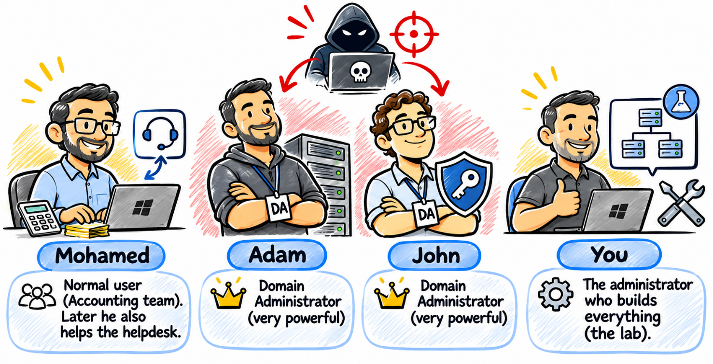
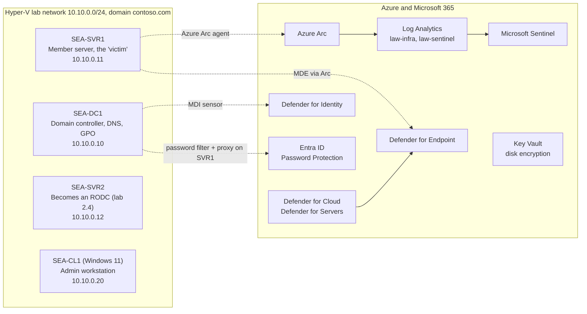
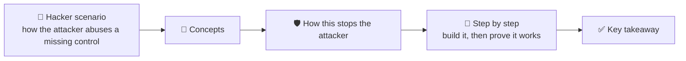

# Windows Server 2025 Security Lab 


**25 hands-on labs that follow one idea: show the attack first, then build the control that stops it, then prove that it works.** Each lab has a *hacker scenario*, the concepts, how the control breaks the attack, a step-by-step build with verification commands, and one key takeaway.

> Most of the time attackers do not break in, they **log in**: a weak password, a hash stolen from memory, an admin account with too many rights. This lab closes those doors one by one, with tools already in Windows Server and Azure.

> ⚠️ **Lab environment only.** Several labs lock accounts, change boot or authentication behaviour, or force BitLocker recovery. Run them on your own isolated virtual machines, with checkpoints, never on production systems. The attacks are *simulated* with harmless commands (failed sign-ins, a test local admin, a test firewall rule, …); this repository contains no exploit code.



## The lab

Four VMs on Hyper-V (all **Generation 2, Secure Boot, virtual TPM**) and an Azure subscription for the cloud chapters.



Cast: **Mohamed** (normal Accounting user, later helps the helpdesk), **Adam** and **John** (Domain Admins, hackers love them) and **you** (the administrator who builds everything).

## How every lab works



## Start here

1. Read [**Welcome and lab setup**](docs/00-welcome-and-lab-setup.md): VM table, domain, users, RSAT, Azure prerequisites and the **extra setup** the labs assume (switch, `Servers` OU, `Policies$` share).
2. Take a checkpoint named *Baseline* of every VM.
3. Do the labs **in order** (later labs reuse earlier results; dependencies are listed in the setup doc).
4. At the end, use the [attack → control map](docs/attack-to-control-map.md) as a self-test: cover the middle column and name the control.

## The 25 labs

### Chapter 1: [Securing the Windows Server operating system](labs/01-securing-the-os/README.md)

| Lab | Attack | Control |
|---|---|---|
| [1.1 Password and lockout baseline](labs/01-securing-the-os/lab-1.1-password-lockout-baseline.md) | Brute force / password spray | Password + lockout policy (Group Policy) |
| [1.2 Exploit protection](labs/01-securing-the-os/lab-1.2-exploit-protection.md) | Memory exploit (buffer overflow) in an unpatched app | DEP, ASLR, CFG, ACG |
| [1.3 App Control for Business (WDAC)](labs/01-securing-the-os/lab-1.3-app-control-wdac.md) | Unknown malware or attacker tools dropped on the server | Allow list, audit mode first |
| [1.4 Credential Guard](labs/01-securing-the-os/lab-1.4-credential-guard.md) | Pass-the-hash after reading LSASS memory | Virtualization-based security |
| [1.5 SmartScreen](labs/01-securing-the-os/lab-1.5-smartscreen.md) | Phishing download / fake download site | SmartScreen, prevent bypass |
| [1.6 Defender for Endpoint](labs/01-securing-the-os/lab-1.6-defender-for-endpoint.md) | Vulnerable third-party app (old 7-Zip) | EDR + vulnerability management |

### Chapter 2: [Securing hybrid Active Directory accounts](labs/02-hybrid-ad-accounts/README.md)

| Lab | Attack | Control |
|---|---|---|
| [2.1 Fine-grained password policy](labs/02-hybrid-ad-accounts/lab-2.1-fine-grained-password-policy.md) | Password spray against a high-value team | PSO |
| [2.2 Entra Password Protection](labs/02-hybrid-ad-accounts/lab-2.2-entra-password-protection.md) | Wordlist built from company words | Global + custom banned lists |
| [2.3 Protected Users](labs/02-hybrid-ad-accounts/lab-2.3-protected-users.md) | Credential theft when a Domain Admin signs in | Protected Users group |
| [2.4 Read-only domain controller](labs/02-hybrid-ad-accounts/lab-2.4-rodc.md) | Stolen branch-office domain controller | RODC + Password Replication Policy |
| [2.5 Authentication policies and silos](labs/02-hybrid-ad-accounts/lab-2.5-authentication-policy-silos.md) | Stolen admin password used on a sensitive server | Authentication firewall |

### Chapter 3: [Least privilege and delegation](labs/03-least-privilege-and-delegation/README.md)

| Lab | Attack | Control |
|---|---|---|
| [3.1 Restricted Groups](labs/03-least-privilege-and-delegation/lab-3.1-restricted-groups.md) | Backdoor admin account (persistence) | Restricted Groups |
| [3.2 Delegation of Control](labs/03-least-privilege-and-delegation/lab-3.2-delegation-of-control.md) | Over-privileged helpdesk account | Scoped delegation |
| [3.3 Kerberos double-hop](labs/03-least-privilege-and-delegation/lab-3.3-kerberos-double-hop.md) | Lateral movement through delegated tickets | Constrained delegation, CredSSP off after use |
| [3.4 Defender for Identity](labs/03-least-privilege-and-delegation/lab-3.4-defender-for-identity.md) | Reconnaissance and attacks against domain controllers | Sensor on the DC |

### Chapter 4: [Watching your servers from Azure](labs/04-watching-from-azure/README.md)

| Lab | Attack | Control |
|---|---|---|
| [4.1 Azure Arc and Log Analytics](labs/04-watching-from-azure/lab-4.1-azure-arc-log-analytics.md) | Attacker clears the Security log | Arc + Azure Monitor Agent |
| [4.2 KQL hunting and alerts](labs/04-watching-from-azure/lab-4.2-kql-hunting-and-alerts.md) | Password spray nobody notices | KQL query + alert on event 4625 |
| [4.3 Microsoft Sentinel](labs/04-watching-from-azure/lab-4.3-microsoft-sentinel.md) | An attack spread across several tools | Correlation, analytics rules, playbooks |
| [4.4 Secure Score](labs/04-watching-from-azure/lab-4.4-secure-score.md) | Owner account without MFA, unpatched server | Defender for Cloud recommendations |

### Chapter 5: [Securing Windows Server networking](labs/05-networking/README.md)

| Lab | Attack | Control |
|---|---|---|
| [5.1 Windows Defender Firewall](labs/05-networking/lab-5.1-windows-firewall.md) | Worm scanning for open SMB / RDP | Host firewall with scoped rules |
| [5.2 IPsec connection security](labs/05-networking/lab-5.2-ipsec-connection-security.md) | Man-in-the-middle / rogue laptop on the LAN | Domain isolation with IPsec |
| [5.3 Firewall review with Windows Admin Center](labs/05-networking/lab-5.3-firewall-review-wac.md) | "Allow all" inbound rule planted by the attacker | Fast review and disable in WAC |

### Chapter 6: [Securing Windows Server storage](labs/06-storage-encryption/README.md)

| Lab | Attack | Control |
|---|---|---|
| [6.1 BitLocker with keys in AD](labs/06-storage-encryption/lab-6.1-bitlocker-ad-recovery.md) | Stolen disk or copied VHDX | BitLocker + recovery key in AD DS |
| [6.2 Forced BitLocker recovery](labs/06-storage-encryption/lab-6.2-bitlocker-forced-recovery.md) | Lost recovery key (availability) | Recovery drill and key rotation |
| [6.3 Encrypting Azure VM disks](labs/06-storage-encryption/lab-6.3-azure-disk-encryption.md) | Azure disk export by a rogue Contributor | ADE and customer-managed keys |

## What you need

| | |
|---|---|
| Host | A Hyper-V host able to run four VMs at once (three Windows Server 2025, one Windows 11 Enterprise), all Generation 2 with Secure Boot and a virtual TPM |
| Azure | Free trial subscription, resource group `az801-rg`, Microsoft Entra ID P2 trial (needed by the Azure labs: 1.6, 2.2, 4.1 to 4.4, 6.3) |
| Microsoft 365 | E5 trial for Defender for Identity (Lab 3.4) |
| Time | The labs that need Azure or Microsoft 365 trials are the ones that expire: plan them together |

Labs that need **no Azure or Microsoft 365 subscription** (a few still need internet, for example the SmartScreen test page): 1.1 to 1.5, 2.1, 2.3, 2.4, 2.5, 3.1 to 3.3, 5.1 to 5.3, 6.1, 6.2.
Labs that **need Azure and/or Microsoft 365**: 1.6, 2.2, 3.4, 4.1 to 4.4, 6.3.

## Repository structure

```
windows-server-security-lab/
├── README.md
├── docs/
│   ├── 00-welcome-and-lab-setup.md     VMs, domain, users, extra setup, lab dependencies
│   ├── attack-to-control-map.md        final review table: attack -> control -> lab
│   ├── progress-checklist.md           tick the labs as you go
│   ├── REVIEW-NOTES.md                 what was added or changed compared to the course text
│   └── images/cast.png
├── labs/
│   ├── 01-securing-the-os/ ... 06-storage-encryption/
│   │   ├── README.md                   chapter intro + lab table
│   │   └── lab-N.M-<name>.md           one file per lab
└── scripts/
    └── lab-N.M-<name>.ps1 / .kql       the commands of each lab, copy them one by one
```

## Scripts

[`scripts/`](scripts) holds every command and KQL query from the labs, with the sentence that introduces it as a comment. They are **snippets to run one by one, on the machine named in the lab**, not scripts to run as a whole. All PowerShell files were checked with the PowerShell parser for syntax errors; they were **not executed** here (no Windows Server lab in this repository's build), so test in your own lab.

## Source and status

The lab text comes from the course document *How to Master Windows Server Security (AZ-801)* (author: Mohamed), converted to Markdown without changing its content, except for the few places marked **⚠️ Added by this repository**, listed in [`docs/REVIEW-NOTES.md`](docs/REVIEW-NOTES.md) together with points to double-check against current Microsoft documentation. Product names and portal paths change often: where the course adds a *2025 note*, it is kept as a 📌 note.

## License

Not chosen yet (the repository is private). Decide before making it public: for example MIT for the scripts and CC BY-NC-SA 4.0 for the course text.
