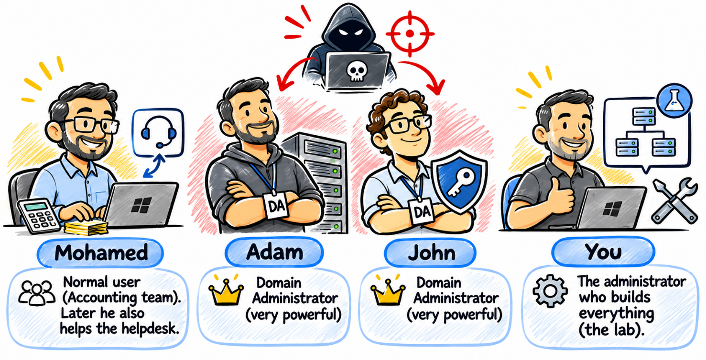

# Welcome and lab setup

[← Back to the README](../README.md)

Hi, and welcome to this course!

Let me ask you a question first. What is the easiest way for a hacker to get into your Windows Server?

Breaking some fancy encryption? Writing a zero-day exploit? Nope. Most of the time they simply **log in**. They guess a weak password, steal a hash from memory, or use an admin account that has way too many rights. Your server opens the door and says "welcome".

In this course I'm going to show you how to close those doors, one by one. We'll use the tools that are already in Windows Server and Azure. No magic, no expensive third-party products.


## How every lab works

Every lab in this course follows the same five steps. Once you get used to it, you'll always know where you are:

1. **Hacker scenario**: put on your black hoodie for a minute. How would an attacker abuse your server if this control is missing? You'll meet a few new words here. Don't worry, we explain them right after.
2. **Concepts**: what is this thing, and how does it work? Now that you've seen the problem, the theory has a reason to exist.
3. **How this stops the attacker**: take the hoodie off. How exactly does our control break the attack you just saw?
4. **Step by step**: we build it, and then we prove it works.
5. **Key takeaway**: the one idea to remember when the lab is over.

Why start with the hacker? Because a solution only makes sense when you know the problem. If I explain Credential Guard first, it's just another feature. If you first watch an attacker steal a Domain Admin's identity from memory, you *want* to know how to stop it. And typing commands without knowing why is like learning to drive by memorising which pedal to push. It works until something unexpected happens.

The course was originally recorded on **Windows Server 2022**. I'm using **Windows Server 2025** in the labs. When something changed (a new name, a retired agent), you'll see a **2025 note**.


## Meet the cast



We'll use the same users in every lab, so the stories are easy to follow:

- **Mohamed**: a normal user who works in the Accounting team. Later he also helps the helpdesk.
- **Adam** and **John**: our Domain Admins. Very powerful accounts. Hackers love them.
- **You**: the administrator who builds everything.


## Building the lab

You start from nothing, so let's build the lab first. I'm using Hyper-V. Here's what we need:

| VM | Role | OS | IP address |
|---|---|---|---|
| SEA-DC1 | Domain controller, DNS, Group Policy | Windows Server 2025 | 10.10.0.10 |
| SEA-SVR1 | Member server, our "victim" | Windows Server 2025 | 10.10.0.11 |
| SEA-SVR2 | Becomes a read-only DC in chapter 2 | Windows Server 2025 | 10.10.0.12 |
| SEA-CL1 | Admin workstation | Windows 11 Enterprise | 10.10.0.20 |

One important thing: create every VM as **Generation 2** with **Secure Boot** and a **virtual TPM**. Why? Credential Guard and BitLocker need them. If you skip this now, you'll be rebuilding VMs in chapter 1. Trust me, I've been there.

Here's how to turn on the virtual TPM on a VM:

```powershell
Set-VMKeyProtector -VMName SEA-SVR1 -NewLocalKeyProtector
Enable-VMTPM -VMName SEA-SVR1
```

The first command gives the VM a key protector. The second one adds the TPM chip. Do this for every VM.

Now the domain. On SEA-DC1:

```powershell
Install-WindowsFeature AD-Domain-Services -IncludeManagementTools
Install-ADDSForest -DomainName contoso.com -InstallDns
```

The server reboots and becomes the first domain controller of **contoso.com**. Join SEA-SVR1, SEA-SVR2 and SEA-CL1 to the domain.

Let's create our cast:

```powershell
New-ADOrganizationalUnit -Name Staff
New-ADGroup -Name Accounting -GroupScope Global -Path "OU=Staff,DC=contoso,DC=com"
$pw = Read-Host -AsSecureString "Password"
New-ADUser Mohamed -Path "OU=Staff,DC=contoso,DC=com" -AccountPassword $pw -Enabled $true
New-ADUser Adam -AccountPassword $pw -Enabled $true
New-ADUser John -AccountPassword $pw -Enabled $true
Add-ADGroupMember "Domain Admins" -Members Adam, John
```

On SEA-CL1, add **RSAT** (the admin tools): *Settings > System > Optional features > Add a feature*, search for **RSAT**, add Active Directory and Group Policy tools.

For the Azure chapters you need an **Azure free trial** subscription, a **Microsoft Entra ID P2 trial**, and a resource group called **az801-rg**.

Last tip: take a **checkpoint** of every VM and call it *Baseline*. Some labs can lock you out of a server. With a checkpoint, you're back in 30 seconds.

Ready? Let's go!

## Extra setup the labs assume

> ⚠️ **Added by this repository, not in the original course text.** The course uses things it never creates. Do these once, before Chapter 1, so the labs work as written.

### 1. Hyper-V networking

The course gives IP addresses (`10.10.0.0/24`) but not the virtual switch. A simple layout:

- One **Internal** (or Private) switch for the lab network `10.10.0.0/24`. Connect all four VMs to it.
- SEA-DC1 is the DNS server. Give each VM a static address, for example on SEA-DC1 (adapt the interface name):

  ```powershell
  New-NetIPAddress -InterfaceAlias "Ethernet" -IPAddress 10.10.0.10 -PrefixLength 24
  ```

  On the other VMs, set their own address and point DNS to the domain controller:

  ```powershell
  New-NetIPAddress -InterfaceAlias "Ethernet" -IPAddress 10.10.0.11 -PrefixLength 24
  Set-DnsClientServerAddress -InterfaceAlias "Ethernet" -ServerAddresses 10.10.0.10
  ```

- Labs that need **internet** (1.5 SmartScreen test page, 1.6, 2.2, 3.4, 4.1 to 4.4) require a second network adapter on an **External or NAT switch** on SEA-SVR1 and SEA-CL1 (and on SEA-DC1 for Lab 3.4, whose sensor reports to the cloud). Keep the lab adapter without a default gateway so that names still resolve through the DC.

### 2. A "Servers" OU

Many labs say "edit a GPO linked to the **servers OU**" (1.2, 1.3, 1.4, 3.1, 6.1), but the course only creates the `Staff` OU. Create the OU and move the member server into it (on SEA-DC1):

```powershell
New-ADOrganizationalUnit -Name Servers
Get-ADComputer SEA-SVR1 | Move-ADObject -TargetPath "OU=Servers,DC=contoso,DC=com"
```

Leave SEA-DC1 (and later SEA-SVR2, the RODC) in **Domain Controllers**. Do not move a domain controller out of that OU.

### 3. A policies share

Labs 1.2 (exploit-protection XML) and 1.3 (App Control `.p7b`) copy a file to `\SEA-DC1\Policies$`. Create it on SEA-DC1 and let computer accounts read it:

```powershell
New-Item C:\Policies -ItemType Directory
New-SmbShare -Name 'Policies$' -Path C:\Policies -ReadAccess 'Domain Computers' -FullAccess 'Domain Admins'
```

### 4. Checkpoints

Take a Hyper-V checkpoint named **Baseline** of every VM after the setup above, and another one before each lab marked *Checkpoint first: Yes* (App Control, Credential Guard, RODC, authentication silos, IPsec, BitLocker).

### 5. Lab dependencies

| Lab | Needs first |
|---|---|
| 1.6 Defender for Endpoint | Azure subscription; connect SEA-SVR1 with Azure Arc (the connection itself is in [Lab 4.1](../labs/04-watching-from-azure/lab-4.1-azure-arc-log-analytics.md)) |
| 2.4 RODC | Setup above (SEA-SVR2 joined to the domain) |
| 4.2, 4.3, 4.4 | [Lab 4.1](../labs/04-watching-from-azure/lab-4.1-azure-arc-log-analytics.md) |
| 6.2 Forced BitLocker recovery | [Lab 6.1](../labs/06-storage-encryption/lab-6.1-bitlocker-ad-recovery.md) |
| 3.3 CredSSP test | Use the built-in **Administrator**, not Adam or John: members of *Protected Users* ([Lab 2.3](../labs/02-hybrid-ad-accounts/lab-2.3-protected-users.md)) cannot use CredSSP or delegation |
